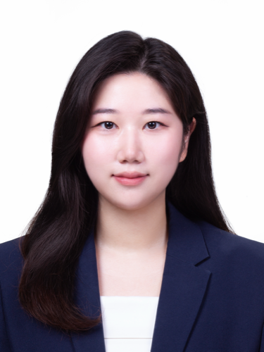
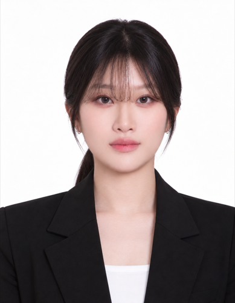
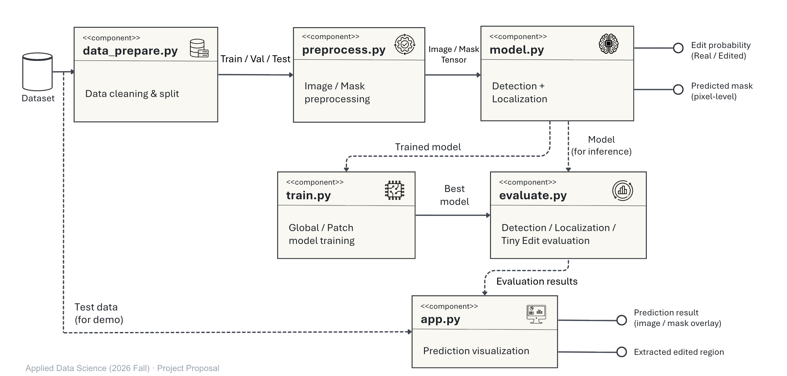
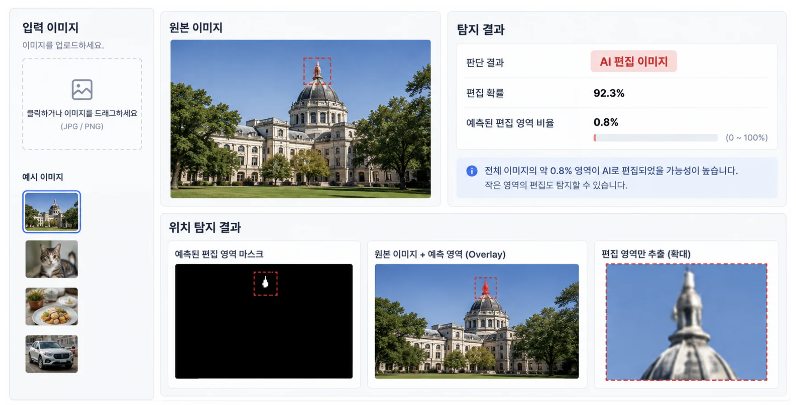

# Tiny-Edit-Guard

실제 사진의 **아주 작은 영역만 생성형 AI로 편집**된 경우에도 편집 여부와 위치를 탐지하는 파이프라인입니다.
편집 면적이 작아질수록 global representation에서 조작 흔적이 희석되는 문제에 주목하고,
의심스러운 **local patch를 선택적으로 보는(Top-k) 방식**이 Tiny Edit 환경에서 이를 완화하는지 검증합니다.

### Team 엘송

<table>
  <tr>
    <td align="center">
      <br/>
      <b>박다영</b><br/>
      데이터<br/>
      <a href="https://github.com/bydayoung">@bydayoung</a>
    </td>
    <td align="center">
      <br/>
      <b>김도연</b><br/>
      모델 · 학습<br/>
      <a href="https://github.com/DoyeonKim9">@DoyeonKim9</a>
    </td>
    <td align="center">
      <br/>
      <b>윤서빈</b><br/>
      모델 · 데모<br/>
      <a href="https://github.com/seobin0224">@seobin0224</a>
    </td>
    <td align="center">
      <br/>
      <b>위지우</b><br/>
      평가<br/>
      <a href="https://github.com/withya16">@withya16</a>
    </td>
  </tr>
</table>

---

## 프로젝트 목적

단순히 "AI 편집 이미지를 탐지할 수 있는가"가 아니라, 다음 질문에 실험으로 답합니다.

1. **편집 영역이 작아질수록** 기존 global detector의 성능은 실제로 감소하는가?
2. Global Average Pooling 대신 **patch-level evidence**를 쓰면 Tiny Edit 탐지를 개선할 수 있는가?
3. 가장 의심스러운 patch를 고르는 **Top-k Aggregation**이 단순 Patch Average보다 효과적인가?
4. 이 효과가 **unseen generator**와 **JPEG·Resize** 환경에서도 유지되는가?

최종 산출물은 분류에서 끝나지 않고 **편집 확률 → 픽셀 mask → overlay → 영역 추출**까지 제공합니다.

---

## 전체 파이프라인



`data_prepare.py`(정제·split) → `preprocess.py`(이미지/마스크 전처리) → `model.py`(Detection+Localization)
→ `train.py`(Global/Patch 학습) → `evaluate.py`(Detection·Localization·Tiny Edit 평가) → `app.py`(예측 시각화)

---

## 데이터셋

원본 벤치마크를 통합·검증한 **Tampered-Images-Combined** 기반. 제공 `mask_ratio`가 실제 mask와
불일치함을 확인하여 **`actual_mask_ratio`를 pixel mask에서 재계산**하고, 편집 크기 구간(`edit_size_bin`)과
mask 유효성(`valid_mask`)을 메타데이터에 명시했습니다.

| 구분 | 수 |
|---|---|
| 전체 | 7,712 (real 3,702 / fake 4,010) |
| Split | train 5,347 · val 1,192 · test 1,173 |
| Test fake 편집크기 | large 287 · medium 106 · tiny 84 · small 81 · invalid_mask 87 |
| Generator | Flux.1 · SD1.5 · SDXL · flux1dev · GLIDE 등 |

> **누수 방지**: 동일 원본에서 생성된 real/fake가 다른 split에 섞이지 않도록 **source 단위 Group Split** 적용
> (split 간 `final_group_id` 교집합 0 검증 완료).
> GT mask가 비어 있는 `flux1dev` 501개는 Detection에만 사용하고 Localization에서는 제외합니다.

---

## 모델

| 모듈 | 역할 |
|---|---|
| `models/backbone.py` | DINOv3 ViT-S/16 — `cls_token` / `patch_tokens` 반환 (patch16 → 512px가 32×32 grid) |
| `models/global_baseline.py` | CLS / Global Average Pooling / CLS+Mean 분류 (비교 기준) |
| `models/segformer_baseline.py` | Localization 비교용 SegFormer-B0 |
| `models/patch_head.py` | patch별 edit score · Patch Average / **Top-k Aggregation** |
| `models/mask_decoder.py` | DINOv3 patch feature(32×32) → pixel mask(512×512) |
| `models/patchguard.py` | **제안 모델** — 분류 + Localization 동시 출력 |
| `losses.py` | BCE(분류) + Dice(mask) + patch supervision |

동일 backbone에서 **aggregation만 바꿔** `Global Average → Patch Average → Patch Top-k`를 비교하여,
성능 변화가 어디서 발생하는지 통제된 조건에서 검증합니다.

---

## 평가 방법

측정 대상은 "모델이 편집을 얼마나 잘 가려내는가"이며, 핵심은 **편집 크기 구간별 성능 분해**입니다.

| 구분 | 지표 |
|---|---|
| Image-level (Detection) | AUROC · AUPRC · F1 (+ bootstrap 95% CI) |
| Pixel-level (Localization) | Dice · IoU · Pixel AUPRC |
| 분해 축 | `edit_size_bin`(tiny→large) · method(seen/unseen) · 변형(JPEG/Resize) |
| 운영 | Inference latency · peak GPU memory · 3-seed mean±std |

**평가 프로토콜 (코드로 강제)**
- threshold는 **validation에서 F1 최대화로 선정** → test에 적용만 (test에서 선정 금지)
- 구간별 AUROC = "해당 구간 fake vs 전체 real"
- Localization은 `label==1 & valid_mask==True`에서만, per-image 계산 후 평균
- **Test 개봉은 모델 동결 후 1회** — `evaluate.py` 기본값이 `val` 채점이라 실수로 test를 볼 수 없음
- 지표 계산 회귀는 **GitHub Actions smoke 테스트**가 매 PR 자동 검증

---

## 웹 데모



이미지를 업로드하면 **AI 편집 여부·편집 확률·편집 영역 비율**을 판정하고,
**예측 마스크 · 원본 Overlay · 편집 영역 확대 크롭**을 함께 보여줍니다.
위 예시는 건물 첨탑만 0.8% 편집된 Tiny Edit 사례로, 작은 편집 영역도 탐지·시각화합니다.

```bash
python3 app.py     # Flask 서버 → 브라우저에서 이미지 업로드
```

---

## 디렉토리 구조

```
Tiny-Edit-Guard/
├── data/
│   ├── 13_preprocess_images.py      # 원본 → 512 리사이즈, images/masks 저장
│   ├── 14_build_dataloader.py       # split별 DataLoader (로컬 processed)
│   ├── dataloader_hf.py             # HF Dataset 로더
│   ├── 15_final_validation.py       # image-mask 무결성 검증
│   └── final_split_metadata.csv     # id·label·method·actual_mask_ratio·edit_size_bin·valid_mask·split
│
├── models/
│   ├── backbone.py                  # DINOv3 ViT-S/16
│   ├── global_baseline.py           # Global/CLS/Mean 분류 baseline
│   ├── segformer_baseline.py        # Localization baseline
│   ├── patch_head.py                # patch score · Top-k aggregation
│   ├── mask_decoder.py              # patch token → pixel mask
│   └── patchguard.py                # 제안 모델 (분류 + localization)
│
├── losses.py                        # BCE + Dice + patch supervision
├── trainer.py                       # optimizer·AMP·checkpoint·validation·export_predictions()
├── train.py / train_hf.py           # 학습 실행 엔트리 (학습 후 preds_val/test.csv 자동 저장)
│
├── evals/                           # 평가 파이프라인
│   ├── predict.py                   # best.pt → 샘플별 예측 + latency/GPU 측정 (선택 경로)
│   ├── metrics.py                   # 지표 단일 모듈 (threshold·bootstrap CI)
│   ├── evaluate.py                  # 구간별/method별 Detection+Localization · MLflow 자동 기록
│   ├── aggregate_seeds.py           # 3-seed mean±std
│   ├── plot_curves.py               # 구간별 AUROC 곡선 (+CI 음영)
│   └── tests/                       # smoke 회귀 테스트 (.github/workflows/evals-smoke.yml)
│
├── app.py + static/ + templates/    # Flask 웹 데모 (업로드 → 판별·mask·overlay)
└── requirements.txt
```

---

## 실행

```bash
pip install -r requirements.txt

# 1) 학습 (GPU) — 끝나면 preds_val.csv / preds_test.csv 자동 생성
python3 train.py                       # 또는 train_hf.py (HF Dataset)

# 2) 채점 (CPU, 몇 초) — MLflow 자동 기록
python3 evals/evaluate.py --trainer-csv preds_val.csv
#    최종(모델 동결 후 1회)만 test 개봉:
python3 evals/evaluate.py --trainer-csv preds_test.csv --val-csv preds_val.csv --eval-split test

# 3) 구간별 AUROC 곡선 (모델 비교)
python3 evals/plot_curves.py results/*__test__detection.csv --out evals/results/curve.png

# 4) 웹 데모
python3 app.py
```

지원 모델: `global` · `global_mean` · `segformer` · `patchguard_avg` · `patchguard_topk`
