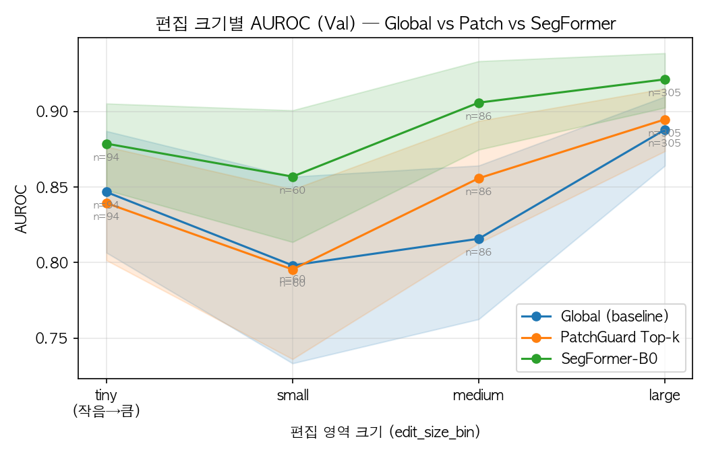

# 평가 1차 결과 보고 (2026-11-15)

> 대상: **global · patch_topk · segformer** (각 seed0, 10 epoch) · **Val 기준**
> 평가: `evals/evaluate.py --trainer-csv` · 모든 수치 MLflow(`tinyedit-guard-eval`) 기록
> threshold = val 선정, 구간별 AUROC = "해당 구간 fake vs 전체 real", Localization = valid_mask & per-image 평균

## 편집 크기별 AUROC 곡선 (Val) — 3개 모델 비교



## Detection (이미지 수준, AUROC)

| 구간 | n(fake) | Global (baseline) | PatchGuard Top-k | SegFormer-B0 |
|---|---|---|---|---|
| 전체 | 635 | 0.831 | 0.840 | **0.872** |
| large | 305 | 0.888 | 0.895 | 0.921 |
| medium | 86 | 0.816 | 0.856 | 0.906 |
| small | 60 | 0.798 | 0.795 | 0.857 |
| **tiny** | 94 | **0.847** | **0.839** | 0.879 |

## Localization (편집 이미지, Dice) — Global은 분류 전용이라 해당 없음

| 구간 | n | PatchGuard Top-k | SegFormer-B0 |
|---|---|---|---|
| 전체 | 545 | **0.413** | 0.316 |
| large | 305 | 0.520 | 0.399 |
| small | 60 | 0.246 | 0.190 |
| tiny | 94 | **0.162** | 0.100 |

## 핵심 관찰 (정직한 현 상태)

1. **"작을수록 어렵다" 추세 재현**: 세 모델 모두 large → small로 AUROC 하락, Localization Dice는 급락(Top-k 0.52→0.16). 프로젝트가 주목한 Tiny Edit 난이도 자체는 실데이터에서 확인됨.
2. **⚠️ 핵심 가설은 아직 미증명**: 제안 모델 **Top-k가 Global 대비 Tiny에서 우위를 못 보임**
   - tiny: Top-k 0.839 **<** Global 0.847 (가설과 반대 방향)
   - 전체: Top-k 0.840 vs Global 0.831 — 차이 작고 **신뢰구간 크게 겹침**
3. 세 모델 중 SegFormer가 전 구간 1등이나, 제안 모델이 아님. 전체 AUROC 0.83~0.87로 목표(NFR-1 ≥0.90) 미달.

## 원인 후보 & 다음 액션

| 후보 | 조치 (모델팀) |
|---|---|
| 10 epoch로 덜 학습 | **Global·Top-k epoch 확대 재학습** → 차이 벌어지는지 확인 |
| Top-k 설정(k값) | k 값 조정 실험 |
| 목표 AUROC 미달 | 학습 충분히 돌려 0.90 도달 시도 |

> **요청**: Top-k·Global을 **동일 조건으로 epoch 늘려 재학습** 후 preds CSV 전달.
> 추가 학습에도 개선이 없으면, 제안서 risk 대응대로 **"Tiny Edit failure analysis"로 결과 방향 전환** 논의.
> preds CSV만 주면 평가·그래프·MLflow 기록은 자동 갱신됨.

## 재현 방법

```bash
python3 evals/evaluate.py --trainer-csv preds/<run>/preds_val.csv --run-name <name>
python3 evals/plot_curves.py \
  evals/results/global__original__val__detection.csv \
  evals/results/patch_topk__original__val__detection.csv \
  evals/results/segformer__original__val__detection.csv \
  --labels "Global (baseline)" "PatchGuard Top-k" "SegFormer-B0" \
  --out evals/results/curve_3models.png
```
