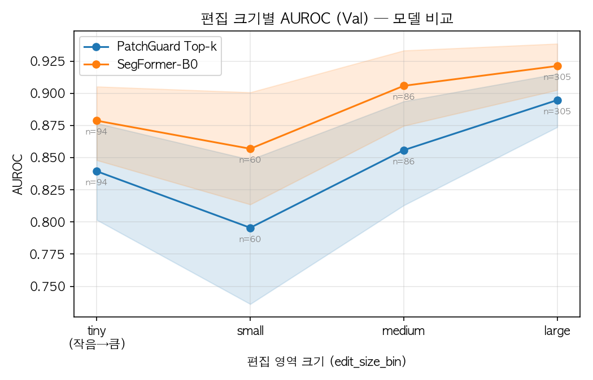

# 평가 1차 결과 보고 (2026-11-15)

> 대상: patch_topk · segformer (각 seed0, 10 epoch) · **Val 기준**
> 평가: `evals/evaluate.py --trainer-csv` · 모든 수치 MLflow(`tinyedit-guard-eval`) 기록
> threshold = val 선정, 구간별 AUROC = "해당 구간 fake vs 전체 real", Localization = valid_mask & per-image 평균

## 편집 크기별 AUROC 곡선 (Val)



두 모델 모두 **편집이 작아질수록 AUROC가 하락** — 프로젝트 가설("Tiny Edit에서 성능 저하")이 실데이터에서 재현됨.
단, **비교 기준인 Global baseline이 아직 없어** "Patch vs Global" 결론은 미완.

## Detection (이미지 수준, AUROC)

| 구간 | n(fake) | PatchGuard Top-k | SegFormer-B0 |
|---|---|---|---|
| 전체 | 635 | 0.840 | **0.872** |
| large | 305 | 0.895 | 0.921 |
| medium | 86 | 0.856 | 0.906 |
| small | 60 | 0.796 | 0.857 |
| tiny | 94 | 0.839 | 0.879 |

## Localization (편집 이미지, Dice)

| 구간 | n | PatchGuard Top-k | SegFormer-B0 |
|---|---|---|---|
| 전체 | 545 | **0.413** | 0.316 |
| large | 305 | 0.520 | 0.399 |
| medium | 86 | 0.426 | 0.347 |
| small | 60 | 0.246 | 0.190 |
| tiny | 94 | **0.162** | 0.100 |

## 핵심 관찰

1. **"작을수록 어렵다" 재현**: 두 모델 다 large → small로 AUROC·Dice 하락. Localization Dice는 급락(Top-k 0.52→0.16, SegFormer 0.40→0.10).
2. **현재 Detection은 SegFormer 우위, Localization Dice는 Top-k 우위** — 단, SegFormer는 localization 특화 모델이라 Detection 비교는 단독 해석 주의.
3. **결정적 한계**: 프로젝트 핵심 주장("Patch가 **Global보다** Tiny에서 낫다")의 비교 상대인 **Global baseline이 없음.** 현재 그래프는 "틀"이며, Global 선이 추가돼야 결론 가능.
4. 전체 AUROC 0.84~0.87 — 목표(NFR-1: ≥0.90) 아직 미달 → 추가 학습 필요.

## 모델팀 요청 사항 (우선순위)

1. **[최우선] Global baseline 학습** — `--model global_cls` (+가능하면 `global_cls_mean`)로 **patch_topk와 동일 조건(seed0·동일 epoch)** 학습 후 `preds_val.csv`/`preds_test.csv` 전달. 비교 그래프 완성의 전제.
2. **Patch Average 학습** — `--model patch_avg`. "Global → Patch Avg → Patch Top-k" 사다리 비교 완성용.
3. **추가 학습(epoch↑)** — 현재 10 epoch는 AUROC 0.84~0.87. 목표 0.90 도달까지 epoch 확대. 같은 모델 재학습해도 CSV만 주면 바로 재채점·비교.

> 공정 비교를 위해 **모든 모델은 동일 seed·동일 학습 설정**으로. preds CSV만 주면 평가·그래프는 자동으로 갱신됨.

## 재현 방법

```bash
python3 evals/evaluate.py --trainer-csv preds/<run>/preds_val.csv --run-name <name>
python3 evals/plot_curves.py evals/results/*__val__detection.csv --out evals/results/curve_val.png
```
